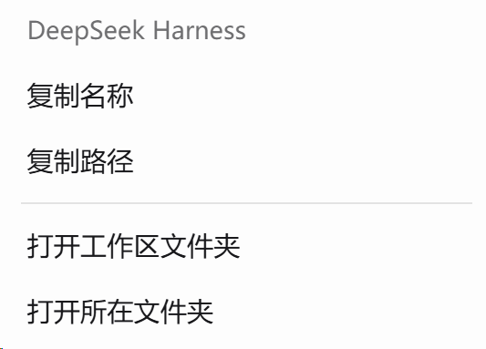
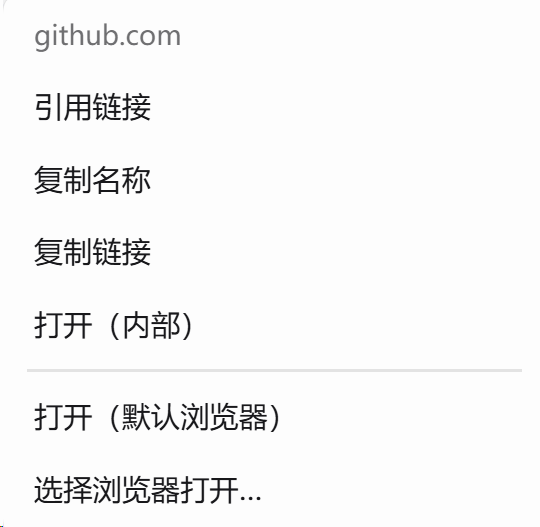

# 右键选项 · DSH 文件右键菜单

在 DeepSeek Harness（DSH）里右键文件、目录、网页链接和工作区，弹出统一的操作菜单。

[](https://www.npmjs.com/package/dsh-file-context-menu)

## 截图

| 文件菜单 | 工作区菜单 | 网页链接菜单 |
|---|---|---|
|  |  |  |

## 支持的右键位置

| 位置 | 右键对象 | 菜单 |
|---|---|---|
| 对话区 | 文件链接 / 交付卡片 / 行内代码路径 | 完整文件菜单 |
| 对话区 | 目录路径（如 `证据库/全文/`） | 目录菜单 |
| 对话区 | 无扩展名路径（如 `工作底稿/说明`） | 自动判断文件/目录 |
| 对话区 | http(s) 网页链接 | 链接菜单 |
| 右侧 Sidebar「文件」树 | 文件夹 | 文件夹菜单 |
| 左侧工作区列表 | 工作区分组行 | 工作区菜单 |

## 菜单

### 文件

| 菜单项 | 作用 |
|---|---|
| 引用该文件 | 把 `@路径` 文件引用插入输入框 |
| 复制名称 | 复制文件名（含扩展名） |
| 复制路径 | 复制绝对路径（解析不到时退回显示路径） |
| 打开（内部） | 在右侧 Sidebar 预览文件 |
| 打开（默认应用） | 交给系统默认程序打开 |
| 选择应用打开… | Windows 系统「打开方式」；macOS 系统应用选择器；其他系统退回应用列表 |
| 打开所在文件夹 | 打开父文件夹并选中该文件 |
| 另存为… | 复制一份到自选位置（`showSaveFilePicker`，不可用时回退下载） |

### 目录 / 文件夹

- 复制名称
- 复制路径
- 打开文件夹

「打开文件夹」直接打开目录本身；「打开所在文件夹」是打开父目录并选中它。

### 网页链接

| 菜单项 | 作用 |
|---|---|
| 引用链接 | 把 URL 文本插入输入框 |
| 复制名称 | 复制链接文字（没有文字时用域名） |
| 复制链接 | 复制 URL |
| 打开（内部） | 在右侧 Sidebar 的浏览器页签中打开 |
| 打开（默认浏览器） | 用系统默认浏览器打开 |
| 选择浏览器打开… | 列出本机浏览器（Edge、Chrome、Firefox、Brave、Vivaldi） |

### 左侧工作区

- 复制名称（工作区标题）
- 复制路径
- 打开工作区文件夹（打开工作区目录本身）
- 打开所在文件夹（在父目录中定位工作区文件夹）

## 安装

在 DSH 的**插件页**安装，或：

```powershell
dsh plugin --profile desktop add dsh-file-context-menu
```

安装后**完全退出并重新启动 DSH**（客户端模块在启动时加载）。

更新：

```powershell
dsh plugin --profile desktop add dsh-file-context-menu@latest
```

卸载：

```powershell
dsh plugin --profile desktop remove dsh-file-context-menu
```

要求：DSH `0.2.1-rc.1` 及以上（`engines.dsh` 已声明）。当前适配 DSH 0.2.1-rc.5。

## 识别范围

- 文件链接（`dsh-resource://file/...`）、交付卡片（`title` 路径）、路径式 `href`
- 对话里的行内代码路径（如 `` `工作底稿/设计.md` ``）
- 约 230 种扩展名，含大写扩展名、UNC 路径、中文/全角符号、含空格文件名、`@"带 空格.docx"` 引用写法
- 带路径分隔符的目录与无扩展名路径

不识别：普通正文里的路径、不带斜杠的裸目录名（写成 `工作底稿/` 即可）、代码表达式。

## 工作原理

- 客户端 `client.js` 捕获对话区、Sidebar 文件树和左侧工作区列表的 `contextmenu`
- 路径解析复用 DSH 的 `remote.session`、`remote.workspaceFiles` 和 `workspaces` 服务
- 宿主 `index.js` 提供四个本机路由：`/file-actions/browsers`、`/file-actions/open-url`、
  `/file-actions/kind`、`/file-actions/open-with`
- 文件引用通过 `conversation.input.shell(sessionId).addFiles()` 插入 `@路径`
- 链接引用通过 `shell.requestDraftInitialization()` 插入 URL 文本

## 隐私

- 插件不上传数据；「另存为」只通过本机会话路由读取文件。
- 诊断上报默认关闭；只有主动执行
  `localStorage.setItem('dsh-file-context-menu.diag', '1')` 后，才会把右键命中信息写入
  **本机内存**的诊断接口（`/file-actions/diag`），不会发送到任何服务器。

## 已知限制

- 链接的「打开（内部）」依赖 Sidebar Browser 页签；Web profile 默认禁用时会提示无法打开。
- 链接引用插入的是 URL 文本（输入框 `@` 引用只支持工作区文件）。
- 「另存为」受 `/api/file` 的字节上限约束（当前约 10 MB）。
- 相对路径无法解析出绝对路径时，只提供「打开（内部）」和「引用」。
- Sidebar 文件树目前只接管文件夹行，文件行右键未接管。
- 依赖 DSH 0.2.x 的客户端服务名（`remote.session`、`remote.workspaceFiles`、`sidebarRight`、
  `shell.overlay`、`workspaces`）；大版本升级后需复核。

## 反馈与更新

- 问题：https://github.com/Dusty-Dustin55/dsh-file-context-menu/issues
- 更新记录：[CHANGELOG.md](CHANGELOG.md)

## License

MIT
